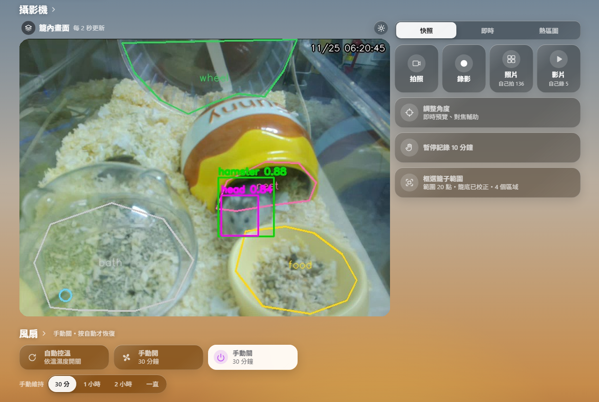

# 倉鼠小屋：樹莓派 AI 倉鼠行為監測系統

用一台樹莓派 5 和一顆相機，24 小時記錄倉鼠的位置與行為：喝水、吃東西、跑滾輪，以及在窩、食盆、浴室、滾輪、水瓶各區的進出與停留時間。另外也監測籠內溫濕度、自動開風扇，有異常時推播到手機。所有運算都在樹莓派上完成，不需要雲端伺服器。



| 重點 | 數字 |
|---|---|
| 倉鼠身體偵測 F1（人工標註、未用於訓練的跑分照片） | 98.0 % |
| 通用模型（動態偵測、預訓練 YOLO、MegaDetector）身體偵測 F1 | 0–17 % |
| 樹莓派 5 單次推論時間 | 約 85 ms |
| 公開資料集 | 3994 張已標註訓練照片、153 段人工標註影片、1623 段錄影 |

## 功能

- **倉鼠偵測**：YOLO11n 模型（ONNX 格式，以 ONNX Runtime 在樹莓派 CPU 上執行）偵測倉鼠的身體與頭部。
- **行為判斷**：依照頭的位置和身體動作，判斷喝水、吃東西、跑滾輪。
- **區域統計**：在網頁上畫出各區域，系統記錄每個區域的進出次數與停留時間。
- **清籠模式**：偵測到手在短時間內反覆進出籠子時，自動暫停記錄，避免把飼主的動作記成倉鼠的行為；也可以在網頁上手動暫停。
- **影片紀錄**：倉鼠活動時自動錄下短片，可在網頁上回看。
- **環境控制**：DHT11 量溫濕度，顯示在七段顯示器上，太熱時用繼電器開風扇。
- **手機推播**：透過 ntfy 推播異常。另外每 5 分鐘向 healthchecks.io 回報一次，系統停擺時會收到通知。
- **網頁儀表板**：即時畫面、統計圖表、熱點圖、區域編輯、訓練照片標註、模型管理、跑分，手機也可以操作。
- **外部連線**：透過 ngrok 提供公開網址，分「唯讀」與「可編輯」兩組密碼，網頁頂端會顯示目前是哪一種模式。
- **自動訓練**：在網頁上標好照片後，系統自動把照片上傳到 Kaggle 用免費 GPU 訓練，練好後先用跑分照片考試，新模型比較好才會換上。

## 系統架構

```
相機 (Picamera2) ──> tracker.py ──> SQLite (hamster.db)
                      │  YOLO11n (ONNX Runtime) 找倉鼠與頭
                      │  背景相減找動作
                      │  行為與區域判斷、錄影
                      ▼
                    web.py (Flask, port 8000) ──> 網頁儀表板
                      │
                      ├─ autotrain.py ──> Kaggle (kaggle_train.py) ──> 新模型 ──> 跑分 ──> 安裝或保留
                      └─ bench_run.py  跑分（照片、樹莓派效能、影片）

climate.py   DHT11 ──> 七段顯示器、風扇繼電器
alerts.py    ntfy 手機推播
heartbeat.py healthchecks.io 心跳
```

## 硬體

- Raspberry Pi 5（4 GB）
- Raspberry Pi 相機模組（固定在籠子上方，斜角往下拍）
- DHT11 溫濕度感測器、MAX7219 七段顯示器、繼電器與風扇

## 主要檔案

| 檔案 | 用途 |
|---|---|
| `tracker.py` | 相機追蹤主程式：偵測、行為與區域判斷、錄影、存訓練照片 |
| `web.py`、`templates/index.html` | 網頁儀表板與 API |
| `yolo_detector.py` | 以 ONNX Runtime 在樹莓派 CPU 上執行 YOLO 模型 |
| `autotrain.py`、`kaggle_train.py` | 自動訓練：打包照片、上傳 Kaggle、訓練、下載、考試、安裝 |
| `bench_run.py` | 跑分：用人工標註、沒用於訓練的照片和影片計算各項指標 |
| `install_model.py` | 安裝訓練好的模型（舊模型保留在模型管理中） |
| `climate.py` | 溫濕度、顯示器、風扇 |
| `alerts.py`、`heartbeat.py` | 手機推播與心跳 |
| `config.toml` | 所有設定（區域、門檻、偵測模式等） |
| `YOLO_GUIDE.md` | 手動標註與訓練流程說明 |
| `hamster-ngrok.service` | 公開網址（ngrok） |
| `*.service`、`*.timer` | systemd 服務設定 |

## 安裝

```bash
cd ~/hamster
cp config.example.toml config.toml   # 再依自己的籠子修改；手機推播在 [alerts] 填自己的 ntfy topic
python3 -m venv --system-site-packages .venv   # 需要系統的 picamera2
.venv/bin/pip install flask opencv-python-headless numpy onnxruntime kaggle
sudo cp hamster-*.service hamster-*.timer /etc/systemd/system/
sudo systemctl daemon-reload
sudo systemctl enable --now hamster-tracker hamster-web hamster-climate hamster-alerts hamster-heartbeat.timer
.venv/bin/python set_password.py   # 設定網頁登入密碼（只存加鹽雜湊）
```

開啟 `http://<樹莓派 IP>:8000`，在網頁上畫出各區域、標出水嘴位置。

## 外部連線（ngrok）

平時只開放給白名單裝置（`config.toml` 的 `[web] allow_ips`），不需要密碼。要讓不在白名單上的人連線時，用 ngrok 開一個公開網址：

1. 到 ngrok 申請免費的固定網域，填進 `hamster-ngrok.service`，再安裝成服務。
2. 設定兩組密碼（兩組不能相同）：
   ```bash
   .venv/bin/python set_password.py --judge   # 唯讀：只能瀏覽
   .venv/bin/python set_password.py --edit    # 可編輯：和白名單裝置相同
   ```
3. 開啟公開網址，帳號隨意，輸入其中一組密碼。

| 連線方式 | 權限 |
|---|---|
| 白名單裝置（直接連線） | 可編輯，不需要密碼 |
| 公開網址＋可編輯密碼 | 可編輯 |
| 公開網址＋唯讀密碼 | 只能瀏覽；修改、刪除、訓練、換模型都會被拒絕 |
| 公開網址，尚未設定任何密碼 | 拒絕連線 |

透過公開網址進來的請求會帶有 `X-Forwarded-For`，系統據此判斷是外部連線；唯讀模式下，伺服器會拒絕所有 GET 以外的請求，所以就算繞過網頁按鈕也無法修改資料。

## 模型訓練流程

1. 系統自動存下照片，優先存模型認錯、漏掉或信心不足的畫面。
2. 在網頁上幫照片畫框（倉鼠身體、頭）。
3. 按「訓練」：照片上傳 Kaggle，用 YOLO11n 在上一版模型的基礎上接著訓練（640 解析度）。
4. 練好後自動用跑分照片考試，新模型分數較高才換上，舊模型都保留可以換回。

到目前共訓練 28 個版本，最終版 v28 使用 3623 張標註照片（其中 1363 張有倉鼠）。

## 資料集

本專案收集與標註的資料公開在 [Releases](https://github.com/Ian684/hamster-monitor/releases)，以 [CC BY 4.0](https://creativecommons.org/licenses/by/4.0/) 授權，使用時請註明出處。

| 檔案 | 內容 | 大小 |
|---|---|---|
| `hamster-dataset.zip` | 訓練照片與 YOLO 格式標註（`0` 倉鼠身體、`1` 頭；沒有 `.txt` 或空白 `.txt` 表示照片中沒有倉鼠）。`data/trained` 為 v28 用過的 3994 張，`data/dataset` 為收集中的照片 | 361 MB |
| `hamster-benchmark.zip` | 跑分資料：63 張人工標註照片（`data/exam`）、153 段影片與人工時間軸（`data/bench/clips/*.lab.json`），未用於訓練 | 267 MB |
| `hamster-clips-part1.zip`、`hamster-clips-part2.zip` | 系統自動錄下的 1623 段倉鼠活動影片（`data/clips`），每段附開始時間與長度；依日期分為 11/12–11/19 與 11/20–11/25 兩包 | 673 MB＋677 MB |
| `hamster-models.zip` | v1–v28 共 27 個模型（NCNN 與 PyTorch `best.pt`，附訓練紀錄） | 514 MB |
| `hamster-database.zip` | SQLite 紀錄（位置、行為、區域停留、溫濕度、推播紀錄）與相簿照片 | 75 MB |

所有影像都來自固定在籠子上方的同一台相機，640×480，包含白天與夜間。

## 驗證方式

所有數字都來自「跑分」資料：由飼主人工標註，沒有一筆用於訓練。

- **跑分照片**：63 張（50 隻倉鼠、42 個頭），涵蓋白天、傍晚與夜間，其中 43 張偏暗。
- **跑分影片**：153 段，共 1.03 小時。飼主標出每段影片中喝水、吃東西、跑滾輪的時間，以及倉鼠在各區域的時間。
- **計分方式**：
  - 照片：計算 mAP50、mAP50-95、精確率、召回率、F1（框和答案重疊 50% 以上算找到）。
  - 影片：系統記錄的事件和飼主標的事件一對一配對，計算精確率、召回率、F1。
  - 每個模型和方法都用同一支程式（`bench_run.py`）計分。

## 結果

### 模型（跑分照片，v28）

| 指標 | 身體 | 頭 |
|---|---|---|
| mAP50 | 100 % | 94.9 % |
| mAP50-95 | 65.9 % | 53.9 % |
| 精確率 | 100 % | 79.6 % |
| 召回率 | 96 % | 92.9 % |
| F1 | 98.0 % | 85.7 % |
| 找到／誤報／漏掉 | 48／0／2 | 39／10／3 |

- 偏暗照片（43 張）身體 F1 97.4%，夠亮照片（20 張）身體 F1 100%。
- 位置判斷正確率 88%：用模型的框判斷倉鼠在哪一區，和用答案框判斷的結果一致的比例。

### 樹莓派效能

AI 每秒分析 1.87 次，單次推論 80 ms（p95 103 ms），相機 14.8 fps，CPU 69%，記憶體 303 MB。

### 整套系統（跑分影片）

影片的分數用的是錄影當下系統實際記錄的事件。系統在 11/22 加入清籠模式等規則更新，所以分成兩段列出。

| 項目 | 全部（153 段） | 11/22 前（124 段） | 11/22 起（29 段） |
|---|---|---|---|
| 喝水 F1 | 52.1 % | 55.6 % | 42.1 % |
| 吃東西 F1 | 63.4 % | 58.1 % | 80.0 % |
| 跑滾輪 F1 | 45.3 % | 30.3 % | 70.0 % |
| 浴室 F1 | 82.1 % | 78.7 % | 95.7 % |
| 食盆 F1 | 85.7 % | 83.0 % | 100 % |
| 滾輪 F1 | 85.4 % | 83.3 % | 91.7 % |
| 窩門口 F1 | 56.7 % | 56.5 % | 57.1 % |
| 水瓶 F1 | 52.7 % | 53.3 % | 50.0 % |

11/22 之後的影片只有 0.22 小時，數字只能看趨勢。

## 模型比較

### 與其他方法比較（沒有用本專案照片訓練）

| 方法 | 說明 | 身體 mAP50 | 身體 F1 | 找到／誤報／漏掉 | 位置正確率 |
|---|---|---|---|---|---|
| 只用動態偵測 | OpenCV MOG2 背景相減 | 4.8 % | 11.6 % | 4／15／46 | — |
| 預訓練 YOLO11n（所有類別） | COCO 預訓練，任何物件都當成倉鼠 | 1.0 % | 1.9 % | 1／53／49 | 10 % |
| 預訓練 YOLO11n（動物類別） | 只算動物類別與玩偶熊 | 3.0 % | 0 % | 0／0／50 | 0 % |
| MegaDetector v5a | 野生動物相機偵測模型（281 MB） | 11.6 % | 16.9 % | 6／15／44 | 16 % |
| **本專案 v28** | YOLO11n 以本籠照片訓練 | **100 %** | **98.0 %** | **48／0／2** | **88 %** |

- **動態偵測**：倉鼠靜止時（吃東西、睡覺、喝水）完全看不到，又常把墊料和光線變化當成倉鼠。
- **預訓練模型**：COCO 沒有倉鼠類別，俯視、光線偏暗的籠內畫面對通用模型是陌生場景。
- **MegaDetector**：外部方法中最好，但 50 隻只找到 6 隻；在電腦 CPU 上每張要 3.5 秒，不適合在樹莓派上即時使用。
- **結論**：通用模型無法直接使用，用本籠照片訓練是準確率提升的關鍵。

### 同樣照片訓練的模型比較

其他常見模型也用和 v28 相同的 3623 張照片，從官方 COCO 權重開始訓練。訓練條件：640 解析度，最多 120 輪，驗證照片固定為同一組 565 張。速度在同一台樹莓派上量測。

| 模型 | 訓練方式 | 大小 | 每張時間 | 身體 F1 | 頭 F1 | 頭 誤報 | 位置正確率 |
|---|---|---|---|---|---|---|---|
| **v28** | YOLO11n，逐版接著訓練 | 10.5 MB | 85 ms | 98.0 % | 85.7 % | 10 | 92 % |
| YOLO11n | 同架構，一次重新訓練 | 10.5 MB | 99 ms | 98.0 % | 89.9 % | 7 | 94 % |
| YOLOv8n | 上一代 nano | 12.6 MB | 85 ms | 96.9 % | 90.9 % | 6 | 92 % |
| YOLO11s | 同家族，大 3.6 倍 | 37.8 MB | 245 ms | 98.0 % | 89.7 % | 6 | 94 % |

- **身體**：四個模型都在 97–99%，差距只有 1–2 隻倉鼠，用本籠照片訓練後架構的影響很小。
- **頭**：三個重新訓練的模型 F1 約 90%，比 v28 高 4–5%，主要差在誤報次數。42 個頭只差 3–4 個，還不足以下定論。
- **速度**：YOLO11s 慢近三倍，準確度卻沒有更好。
- **選 YOLO11n 的原因**：準確度和其他架構相當，速度在最快的一組，大小最小，適合在樹莓派上即時執行。

（本表的位置正確率是 4 個模型在同一場重新計算的，可互相比較，但與上方跑分的 88% 屬於不同場次。）

### 模型演進

| 版本 | 主要改變 | 訓練照片（含倉鼠） | 身體 F1 | 頭 F1 | 位置正確率 |
|---|---|---|---|---|---|
| v1 | 第一版，只有「倉鼠」一類 | — | 44.8 % | — | 26 % |
| v4 | 新增「頭」類別 | — | 73.4 % | 53.3 % | 54 % |
| v5 | 改由樹莓派自動收集照片、自動上 Kaggle 訓練 | 154（138） | 77.3 % | 68.6 % | 66 % |
| v7 | 照片增加近 9 倍，大量加入沒有倉鼠的照片 | 1354（386） | 86.0 % | 71.4 % | 76 % |
| v13 | 特訓：挑出模型較弱的畫面加強訓練 | 約 2000（約 650） | 94.8 % | 82.5 % | 84 % |
| v23 | 頭部表現最佳 | 2995（1044） | 98.0 % | 91.6 % | 88 % |
| v28 | 最終版 | 3623（1363） | 98.0 % | 85.7 % | 88 % |

- v5 → v7：加入大量沒有倉鼠的照片，讓模型學會「什麼不是倉鼠」。
- v12 → v13：照片量差不多，改為針對弱點加強訓練，身體 F1 從 80% 升到 94.8%。
- v22 之後身體 F1 都在 93–99%，已接近上限。
- 訓練設定：v1–v4 每輪最多 80–100 次，v5–v19 為 60 次，v20 起改為 40 次並把學習率降為四分之一，讓新照片補強模型而不洗掉舊的學習。

## 失敗案例

### 照片（模型）：63 張中 14 張出錯

| 類型 | 次數 | 說明 |
|---|---|---|
| 同一隻倉鼠多報一個頭 | 4 次頭誤報 | 背對鏡頭時，屁股或身體側邊被多框成第二個頭 |
| 頭只露一點 | 2 次頭誤報 | 倉鼠從管子探出頭，飼主判斷看不到頭、模型框了頭 |
| 籠外物體 | 2 次頭誤報 | 白天畫面右側邊緣、籠壁外的東西被當成頭 |
| 頭尾判斷錯 | 1 次漏掉＋1 次誤報 | 夜間背對鏡頭，頭框框在屁股 |
| 低頭時頭框太大 | 1 次漏掉＋1 次誤報 | 低頭只露頭頂，框的位置對但大小不準 |
| 頭埋在食盆裡 | 1 次漏掉 | 吃東西時頭被食盆邊緣擋住 |
| 身體只露在畫面邊緣 | 1 次漏掉 | 只露一小塊，信心 0.37，低於門檻 0.45 |
| 在畫面最上緣、手同時入鏡 | 1 次漏掉 | 倉鼠在滾輪區畫面頂端，同時飼主的手在籠內 |
| 區域邊界 | 2 次位置錯 | 框的位置正確，但中心剛好落在區域線附近，被判到隔壁區 |

### 影片（整套系統）

**喝水（多報 26 次、漏記 9 次）**：最主要的問題。

| 原因 | 次數 |
|---|---|
| 在浴室裡、靠近水嘴，但沒有在喝 | 16 |
| 在水瓶區，但沒有在喝 | 6 |
| 有在喝，但時間對不上或一次被拆成兩段 | 4 |
| 漏記：喝水時間很短（0.7 秒、1.4 秒） | 2 |
| 漏記：其他 | 7 |

鏡頭斜角往下拍，畫面上分不出倉鼠的嘴是貼在管口，還是在管口後面。把判斷改嚴雖然能減少誤判，但真的喝水也會一起漏掉。系統記的水瓶區停留時間是實際的約 3–6 倍。

**跑滾輪（多報 27 次、漏記 2 次）**

| 原因 | 次數 |
|---|---|
| 11/22 前（舊規則）：清籠時手伸進籠內被當成跑步，或在滾輪區但沒在跑 | 21 |
| 11/22 起：在滾輪區但沒在跑（坐著、走動，滾輪小幅晃動） | 3 |
| 11/22 起：同一次跑步被拆成多段，或時間對不上 | 3 |
| 漏記：跑步時間很短，或錄影一開始就在跑 | 2 |

加入清籠模式等規則更新後，跑步 F1 從 30% 升到 70%。滾輪大部分在畫面上緣以外，系統只看得到一角，再從轉動判斷倉鼠有沒有在跑，所以滾輪自己晃動和倉鼠在跑不容易分開。

**吃東西（多報 6 次、漏記 9 次）**

| 原因 | 次數 |
|---|---|
| 漏記：在食盆裡吃，但系統沒記到 | 9 |
| 在食盆裡但沒在吃 | 3 |
| 時間對不上或被拆段 | 2 |
| 手伸進籠內 | 1 |

吃東西的判斷要求「頭在食盆、身體在動」。漏記很可能是動作太小（例如把食物塞進頰囊），達不到門檻。

**窩門口（召回率 44–45%）**：系統只在倉鼠在門口、看得到時才算在窩門口區；進到窩裡或被窩擋住就看不到，所以停留時間少算約 40%。

## 使用限制

| 限制 | 說明 |
|---|---|
| 鏡頭與擺設不能移動 | 區域依固定鏡頭畫出；移動鏡頭或重新擺放後，要重畫區域、重設水嘴位置，最好補標照片重新訓練 |
| 只支援一隻倉鼠 | 多隻會互相混淆 |
| 極暗環境未驗證 | 跑分照片中沒有亮度 15 以下的照片。人工調暗測試中，亮度降到 33 以下時身體召回率掉到 45% 以下（人工雜訊比真實情況重，僅供參考） |
| 很短的動作會漏掉 | AI 每秒分析約 1.9 次，不到 1–2 秒的喝水或跑步可能完全沒被看到 |
| 喝水只能當參考 | 精確率 29–48%，喝水次數與時間不能當準確紀錄 |
| 滾輪大部分在畫面外 | 跑步判斷依賴滾輪轉動；滾輪圈數與距離沒有經過人工驗證 |
| 手只伸進一次不會觸發清籠模式 | 例如放食物時，手的動作可能被記成行為；可以先在網頁上手動暫停 |
| 窩內看不到 | 窩內活動無法記錄，窩門口停留時間會少算 |
| 模型只適用這個籠子 | 用在別的籠子、別隻倉鼠或不同光線時，需要重新收集照片訓練 |
| 驗證規模有限 | 照片 63 張、影片 1.03 小時，其中現行規則只有 0.22 小時 |

## 改進方向

1. **喝水**：在水瓶旁加第二個角度的鏡頭，或加飲水量感測器輔助判斷。
2. **吃東西**：改用頭部的細微動作（咀嚼）判斷，而不是整個身體的動作。
3. **頭部誤報**：定期用全部照片一次重新訓練，取代逐版接著訓練；比較實驗中頭部 F1 可從 85.7% 提升到約 90%。
4. **區域邊界**：改用框的底部（腳的位置）判斷區域，而不是框的中心。
5. **驗證工具**：做離線重播工具，讓新規則直接在已標註的跑分影片上重跑，每次修改都能立即得到完整分數。

## AI 工具與第三方資源使用揭露

- **生成式 AI**：開發過程使用 Anthropic 的 Claude 協助程式撰寫與除錯、實驗腳本設計、數據整理及文件整理。系統需求與功能規劃、硬體組裝、資料收集與標註、模型訓練決策及結果檢核由團隊完成，文中數據皆為實際量測結果。
- **預訓練模型與開源套件**：Ultralytics YOLO11（COCO 預訓練權重）、ONNX Runtime、OpenCV、Picamera2、Flask、SQLite；比較實驗另使用 YOLOv8、MegaDetector 與 COCO 預訓練模型。
- **資料與服務**：訓練與驗證影像皆由本團隊自行拍攝與標註；雲端訓練使用 Kaggle，推播使用 ntfy。

## 開發團隊

- [Ian684](https://github.com/Ian684)：系統開發、硬體整合、網頁、自動訓練與驗證、中後期模型訓練與資料標記
- [ericodin960811](https://github.com/ericodin960811)：前期模型訓練、資料標記與資料整理、跑分照片與影片標註

## 授權

資料集（Releases 中的照片、影片、標註與模型）以 [CC BY 4.0](https://creativecommons.org/licenses/by/4.0/) 授權。
